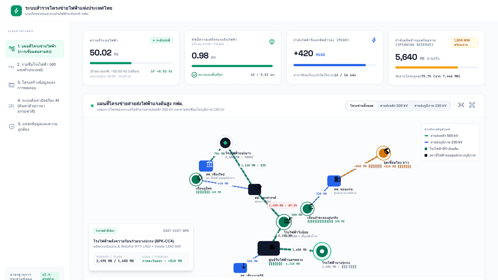
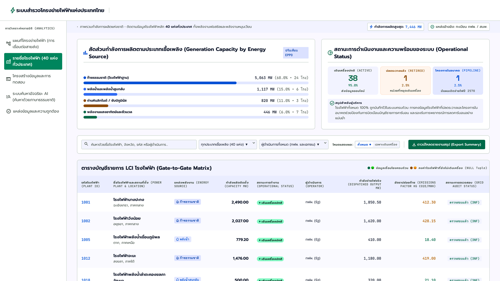
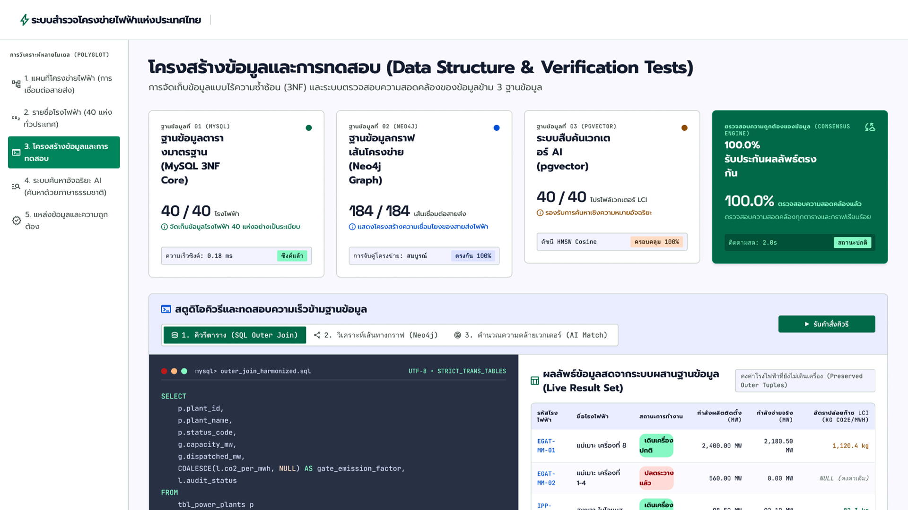
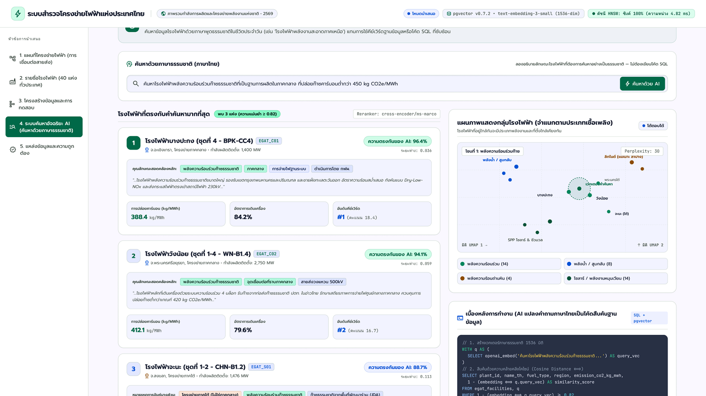

# Thailand Power Grid LCI Explorer

<p align="start">

   
  
</p>


## ✨ Overview
Thailand Power Grid LCI Explorer is a comprehensive energy network exploration and analytics platform built to monitor national power generation, transmission topology, and environmental life cycle inventory (LCI) data.

Inspired by the real-world power infrastructure of Thailand, the system integrates a polyglot persistence architecture combining MySQL (relational 3NF core data), Neo4j (transmission line graph network), and pgvector (AI semantic search). Users can analyze system frequency, track power plant status, evaluate greenhouse gas emission factors (ISO 14040/44 standards), and query data using natural language processed directly into SQL.

Jump straight into the platform to monitor grid stability, explore the national power plant matrix, and run data verification tests—available as a standalone Windows executable or directly from source.


## 📥 Download

### Demo Website (Recommended)

Open website we deployed with Vercel

https://thailand-power-grid-explorer.vercel.app

### Local Download

Install directly from repository.

```
Requires Node 18.17+.
1. Open a terminal IN this folder (the one containing package.json)
2. npm install
3. npm run dev
4. Open http://localhost:3000
```

## 📸 Screenshots

<table>
<tr>
<td align="center">

</td>

<td align="center">

</td>
</tr>
<tr>
<td align="center">

</td>

<td align="center">

</td>
</tr>
</table>

## ⭐ Support

If you enjoy Thailand Power Grid LCI Explorer, consider giving this repository a ⭐.

It helps more people discover the project and supports future development.
